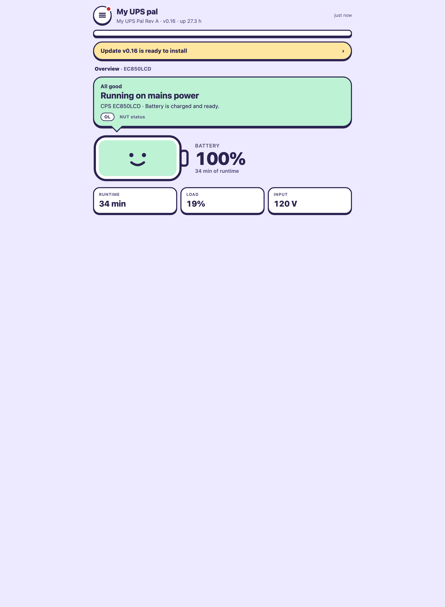

# My UPS Pal 

**Put a USB-only UPS on your network. No Raspberry Pi, no SD card, no vendor network
card that costs more than the UPS.**

Plug it into the UPS's USB port and it is a Network UPS Tools server on TCP 3493. Home
Assistant, Synology, TrueNAS, unraid and `upsmon` connect to it the way they connect to
`upsd`, because that is what it is.

  

## Specifications

The production board, Rev B. Rev A differs in memory and fuse rating; see
[`docs/rev-a.md`](docs/rev-a.md).

| Board | |
|---|---|
| Size | 36 × 58 mm, two layers |
| Module | ESP32-S3-WROOM-1-N16R8: 16 MB flash, 8 MB PSRAM |
| Temperature | module rated to 65 °C |

| Power | |
|---|---|
| Input | 5 V over USB-C |
| Draw | about 0.08 A (0.4 W) in normal operation |
| Worst case | about 0.5 A, so any 1 A USB charger is enough |

| Ports | |
|---|---|
| UPS port | USB-A host with switched, current-limited power (1 A) |
| Computer port | USB-C for power, programming and console, with auto-reset |
| Protection | ESD protection on both USB ports and a 3 A resettable fuse |
| Lights | STATUS and FAULT LEDs |
| Display | header for an optional 0.96-inch OLED |
| Buttons | BOOT and RESET. Press BOOT five times to clear Wi-Fi and login. |

| Connectivity | |
|---|---|
| Wi-Fi | 2.4 GHz, 802.11 b/g/n |
| Setup | captive portal on `ups-esp32-XXXX` at `192.168.4.1` |
| Address | `ups-esp32-XXXX.local` over mDNS, or a fixed IP if you set one |
| Remote | Tailscale, built in |

| Protocols | |
|---|---|
| NUT server | TCP 3493, UPS name `ups`. Reads need no login. |
| UPS input | USB HID Power Device, polled |
| Metrics | Prometheus `/metrics`, names follow `nut_exporter` |
| Web page | live readings, battery gauge, NUT connection string and UPS controls, over HTTPS |
| NUT commands | self-test, beeper and shutdown, if your UPS supports them. Shutdown needs `OFF` typed to arm it. |

| Firmware | |
|---|---|
| Updates | over the air, signed, one click to install. Rolls back on its own if an update is bad. |
| Recovery | reconnects after a Wi-Fi drop or a UPS replug |
| History | long readings history and an outage log |
| Login | needed for setup, web changes and NUT commands |
| Build | ESP-IDF 5.5.5 |

| Enclosure | |
|---|---|
| Print | no supports. The cover snaps on, so no screws. |
| Wall mount | two countersunk holes for #6 / 3.5 mm screws, 23 mm apart |
| Details | light pipes for the LEDs and pinholes for RESET and BOOT |
| Files | STL, plus a three-colour 3MF for Bambu Studio and Orca |

---

## What it does

- **Speaks NUT.** The real protocol on port 3493. It reports what the UPS's own USB
  descriptor provides (charge, runtime, voltage, load, status) and offers only the
  controls that UPS has: self-test, beeper, shutdown. A value the UPS does not expose is
  absent, never guessed at.
- **A web page** with the readings in plain words, the UPS's controls, and the NUT
  connection string ready to paste into a client.
- **Set up in a browser.** First power raises a Wi-Fi access point; pick your network and
  the board is at `ups-esp32-XXXX.local`.
- **Updates itself**, signed, with automatic rollback if a new version does not come up.
- **Recovers on its own** from a Wi-Fi drop or a UPS that stops answering.
- **Prometheus `/metrics`** and an optional OLED display.

## Works with

| Client | Configuration |
|---|---|
| **Home Assistant** | Add the built-in **NUT** integration. Usually discovered on its own; otherwise host `ups-esp32-XXXX.local`, port `3493`, UPS name `ups`, no credentials. |
| **Synology DSM** | Control Panel → Hardware & Power → UPS → *Network UPS server*, point at the board's address. |
| **TrueNAS / unraid** | UPS service in "slave" or network mode, same address and port. |
| **Linux** | `upsmon` / `upsc ups@ups-esp32-XXXX.local` |
| **Prometheus** | Scrape `http://ups-esp32-XXXX.local/metrics` directly. Metric names follow `nut_exporter`, so its dashboards and alerts carry over. |

Which UPSes work: [`docs/tested-ups.md`](docs/tested-ups.md).

---

## The boards

**Rev B** is the production board: an ESP32-S3-WROOM-1-N16R8 with the memory for
Tailscale, a long readings history, an outage log and HTTPS, on top of everything above.
Its hardware design is not published.

**Rev A** is the first board, an open-hardware design under CERN-OHL-S v2: schematic,
layout, bill of materials and printable case are in this repository, and it keeps
receiving every firmware release. See [`docs/rev-a.md`](docs/rev-a.md).

Both run the same firmware from this repository; each release carries an image for each.

---

## Getting started

1. Download `ups-adaptor-<board>-full.bin` from [Releases](../../releases) and flash it
   over USB: `esptool.py --chip esp32s3 write_flash 0x0 ups-adaptor-revb-full.bin`
2. Join the `ups-esp32-XXXX` access point, open `http://192.168.4.1/`, choose your
   network and set the login.
3. Point your NUT client at port 3493, UPS name `ups`.

The full walk-through, including the login, a fixed address and recovery, is in
[`docs/getting-started.md`](docs/getting-started.md). Building from source:
[`firmware/README.md`](firmware/README.md).

Boards labelled "UPS to ESP32 Module" are the same product under its earlier name and
update as before.

---

## Documentation

| | |
|---|---|
| [`docs/getting-started.md`](docs/getting-started.md) | flashing, setup, the login, a fixed address, recovery |
| [`docs/tested-ups.md`](docs/tested-ups.md) | supported UPSes: verified on hardware, verified against their USB descriptors, and what cannot work |
| [`docs/updates.md`](docs/updates.md) | how a board updates, signed images, update channels |
| [`docs/firmware.md`](docs/firmware.md) | architecture, HID-to-NUT mapping, the protocol subset, the web API |
| [`firmware/README.md`](firmware/README.md) | building and flashing the firmware |
| [`docs/rev-a.md`](docs/rev-a.md) | the Rev A board: photos, case, schematic, the optional display |
| [`docs/hardware.md`](docs/hardware.md) | Rev A specification, pin map, power tree, editing the design |
| [`docs/hardware-schematic.md`](docs/hardware-schematic.md) | every Rev A net and pin |
| [`docs/circuit.md`](docs/circuit.md) | the one-page circuit description |
| [`docs/BOM.md`](docs/BOM.md) | parts, and the substitutions that would break the board |
| [`docs/jlcpcb.md`](docs/jlcpcb.md) | manufacturing limits, and what to check before ordering |
| [`docs/privacy.md`](docs/privacy.md) | what the board sends, and how to turn it off |
| [`SECURITY.md`](SECURITY.md) | reporting a problem; what someone with the board in their hands can read |
| [`docs/licensing.md`](docs/licensing.md) | firmware, hardware and trademark licences |
| [`docs/CHANGELOG.md`](docs/CHANGELOG.md) | what changed in each release |

---

## Security and privacy

Updates are signed and checked by the board before they install. The login protects the
settings and controls from other devices on your network; reading the UPS never needs it.
What someone with physical access to the board can read, and what to do about it, is in
[`SECURITY.md`](SECURITY.md). What the board sends home (a short check-in, off in one
click) is in [`docs/privacy.md`](docs/privacy.md).

## Licence

Firmware: GPL-3.0-or-later. Rev A hardware: CERN-OHL-S v2. The name and logo are
trademarks and not covered by either. Details, including third-party code and how to
contribute: [`docs/licensing.md`](docs/licensing.md).

The design and direction are the author's; [Claude Code](https://claude.com/claude-code)
wrote most of the firmware and documentation under the author's review.

---

&nbsp; <b>Designed in Canada</b>

