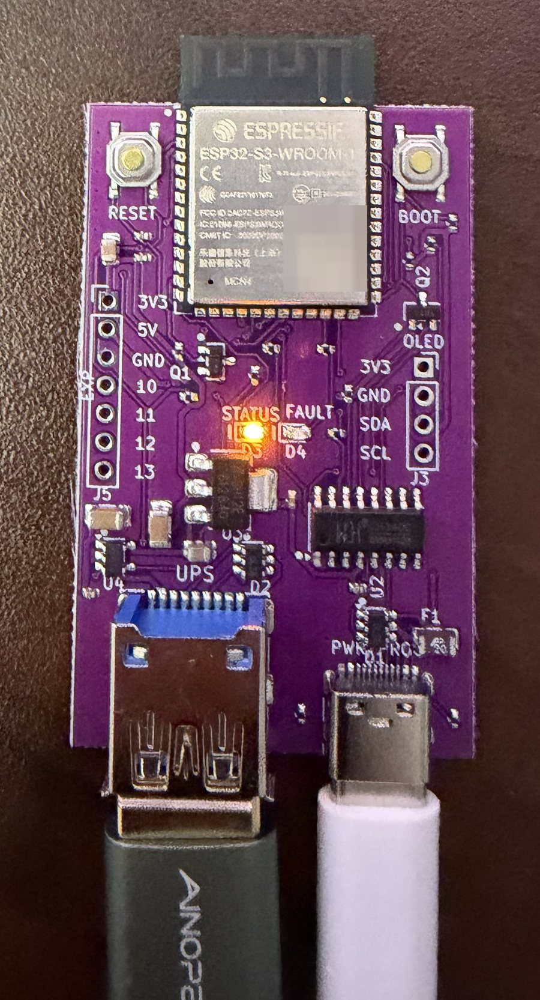
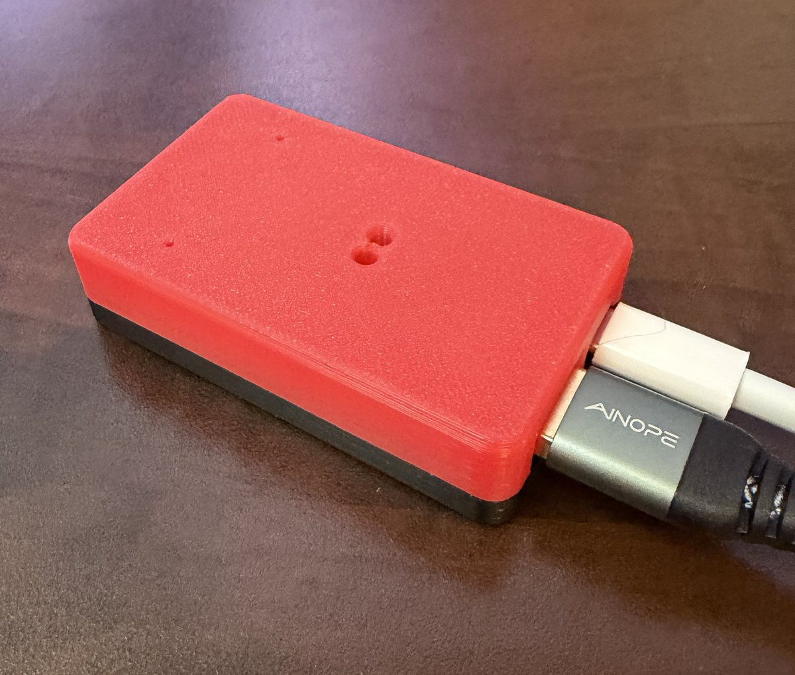
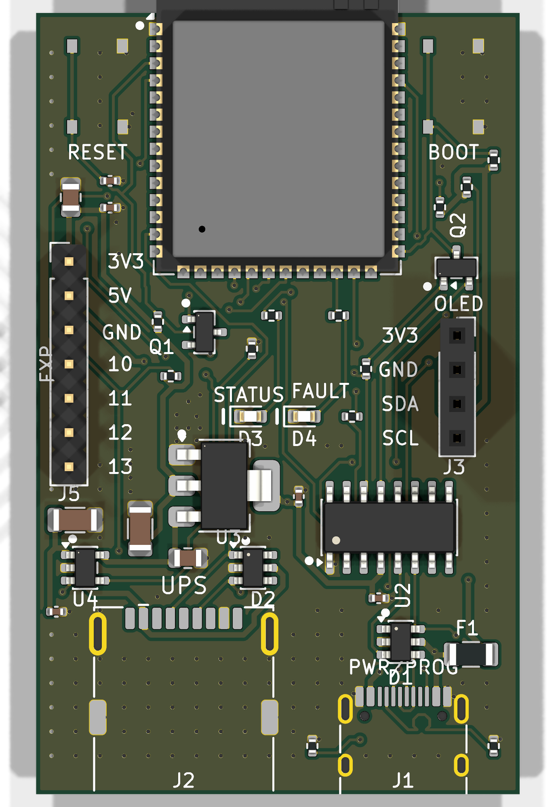
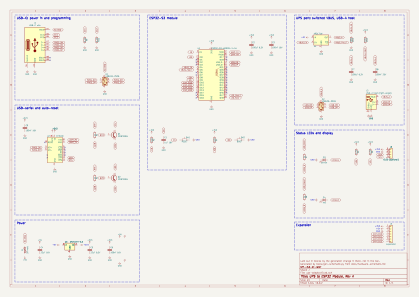
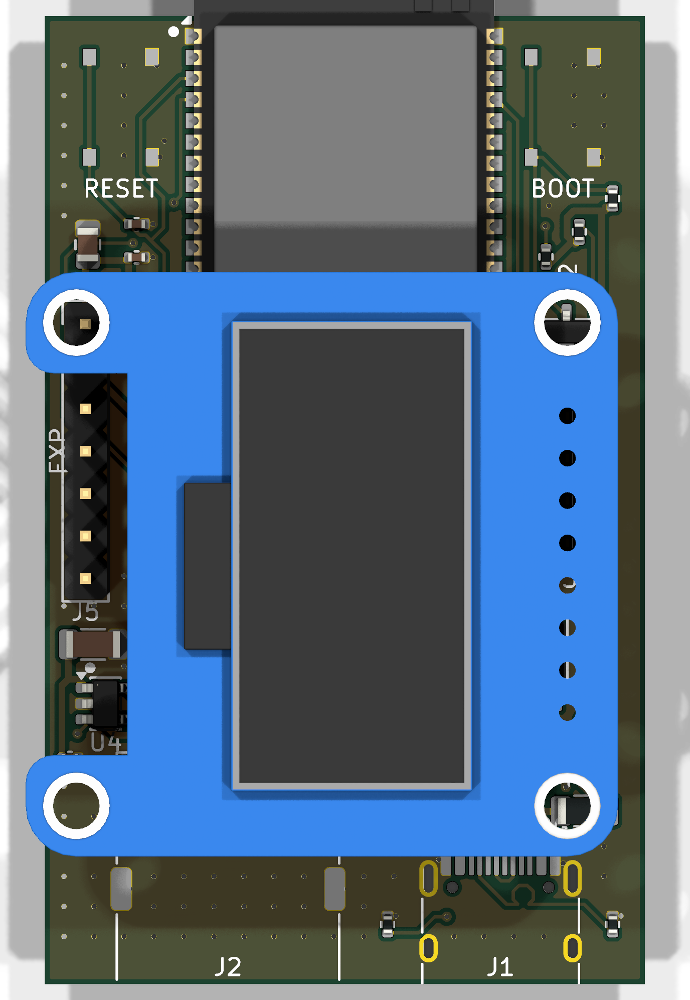

# The Rev A board

Rev A is the first My UPS Pal board and an open-hardware design: 36 × 58 mm, two
layers, ESP32-S3-WROOM-1-N4, published under CERN-OHL-S v2. Its schematic, layout,
bill of materials and case are in this repository, and it receives every firmware
release alongside Rev B.

  
  &nbsp;&nbsp;
  

- **USB-A host port** to the UPS, with switched, current-limited VBUS: a UPS's USB port
  supplies no power itself, so the board provides it
- **USB-C** for power, programming and console via a CH340C with auto-reset
- ESD protection on both ports, a 2 A resettable fuse
- Expansion header, and an I²C header for an optional 128×64 SSD1306 OLED
- Every part on the top side, because JLCPCB's Economic PCBA places one side only

The photos are a real board, running, and the same board in its printed case. The
other views on this page are renders of the design.

Specification, pin map and power tree: [`hardware.md`](hardware.md). Every net and pin:
[`hardware-schematic.md`](hardware-schematic.md). Parts: [`BOM.md`](BOM.md).
Ordering: [`jlcpcb.md`](jlcpcb.md).

## The case

Printable, no supports, no screws needed to close it: the board drops into the tray, and
the cover snaps on and holds it down. STLs are in
[`../hardware/enclosure/`](../hardware/enclosure/).

| File | What it is |
|---|---|
| `ups-adaptor-tray.stl` | the tray, for sitting on a shelf |
| `ups-adaptor-tray-wall.stl` | **wall-mount tray**: two countersunk holes for #6 / 3.5 mm flat-head wood screws, 23 mm apart on the centreline. Screw the empty tray to the wall, drop the board in, snap the cover on: the screws end up hidden inside |
| `ups-adaptor-cover.stl` | the cover, with light pipes over the LEDs and pinholes for RESET and BOOT |
| `ups-adaptor-lightpipes.stl` | two 3 mm light pipes for the plain STL covers, printed in clear PETG and pressed into the light pipe guides |
| `ups-adaptor-cover-labelled.3mf` | the cover as a three-colour Bambu Studio / Orca project: STATUS, FAULT, RESET and BOOT inlaid into the top in filament 2, and the light pipes printed straight into the case in filament 3, no rod to press in. A thin plug sits inside each light pipe's chamfered opening, printed in the first layers against the bed; the guide tube stays open below it down to the LED, so it reads as a lit window |
| `ups-adaptor-cover-noname.stl`, `-noname-labelled.3mf` | the same cover without the name |
| `ups-adaptor-cover-blank.stl` | the cover with no words at all |
| `ups-adaptor-cover-oled*.stl`, `.3mf` | the same covers with a window for a display on J3 |

Both trays carry "Contains FCC ID: 2AC7Z-ESPS3WROOM1" and "Contains IC: 21098-ESPS3WROOM1"
engraved underneath: the Wi-Fi module's certification requires them on the outside of
anything it is enclosed in. They are not a compliance claim for the board itself.

Either tray takes either cover. Print the cover upside down, as the STL is oriented; the
labels are then the first layers, so a multi-colour print changes filament only there.

## Schematic

[PDF](schematic.pdf) · [SVG](img/schematic.svg) · KiCad source in
[`../hardware/kicad/`](../hardware/kicad/). The schematic is exported from the same
design the board is built from.

## The optional display

The I²C header is positioned so a 0.96" module sits **flat over the board** rather than
hanging off an edge. Illustrative: the 3D model is an Adafruit breakout standing in for
the generic modules most people buy.

> [!CAUTION]
> **Never plug a standard OLED module straight into Rev A's J3. It will be destroyed.**
> J3 reads **3V3, GND, SDA, SCL** from pin 1 (the square pad). Nearly every 0.96" SSD1306
> module reads **GND, VCC, SCL, SDA**, so seated directly it gets 3V3 on its ground pin.
>
> **To use a display on Rev A, do one of these:**
>
> 1. **Buy a VCC-first module**: 0.96", 4-pin I²C, SSD1306, with the pins labelled
>    **VCC, GND, SCL, SDA** in that order. Its power pins match J3, so it plugs straight in.
>    Check the photo of the pin labels before ordering, because listings reuse stock
>    photos.
> 2. **Or cross the power pins on a standard module**: wire it with four jumpers:
>    module **VCC → J3 pin 1**, module **GND → J3 pin 2**, SCL → pin 3, SDA → pin 4.
>    Only the power pair crosses.
>
> Either way, flash the **`reva-oled`** build (`ups-adaptor-reva-oled-full.bin` for a
> first flash over USB; a board on it then updates itself from then on): it swaps SDA
> and SCL for the display in software to match. The plain Rev A release leaves the
> display off, because it cannot know which way round your module is wired. **Before
> first power, read the labels on the module in your hand and put VCC on J3's square
> pad.**
